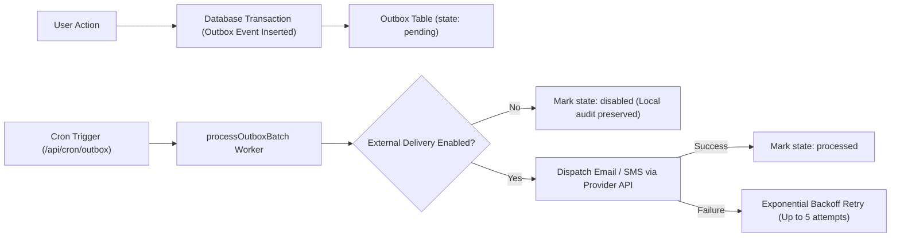

# ENGINE//OS — Integration Status & External Provider Architecture
Version: 1.0 · Date: 2026-11-08 · Author: Gemini Coding Agent

---

## 1. Integration Status Classification

| Integration Area | Classification | Implementation Status | Policy State | Next Action |
|---|---|---|---|---|
| **Database (Supabase PostgreSQL)** | Core Infrastructure | Migration SQL authored & verified | Awaiting Credentials | Apply to staging Supabase instance |
| **Authentication (GoTrue SSR)** | Core Infrastructure | SSR middleware & session refresh wired | Awaiting Credentials | Configure redirect URLs in staging |
| **Storage (Supabase Storage)** | Core Infrastructure | Uploader & path guards implemented | Awaiting Credentials | Provision `project-files` bucket |
| **Payment Gateway Adapters** | Tested Adapter | Stripe, SSLCommerz, bKash adapters implemented | GATED (HOLD BY POLICY) | Founder to configure gateway sandbox |
| **Notification Outbox Worker** | Tested Adapter | Exponential backoff worker & cron endpoint ready | GATED (HELD INTERNALLY) | Founder to configure transactional email |
| **Pre-Registration Draft Claiming** | Implemented & Tested | Opaque SHA-256 token API active | ACTIVE IN DEV | Verify in staging database |

---

## 2. Payment Gateway Architecture & Provider Comparison

To support both Bangladesh domestic commerce (BDT) and international clients (USD), ENGINE//OS implements provider-agnostic payment processing governed by integer minor units.

### 2.1 Provider Evaluation Matrix

| Provider | Supported Currencies | Local Payment Methods | Webhook Verification Protocol | Sandbox Testing Readiness |
|---|---|---|---|---|
| **SSLCommerz** | BDT, USD | Visa, Mastercard, bKash, Nagad, Rocket, Bank Transfer | IPN POST with `verify_sign` & `store_passwd` MD5 hash | High (Standard BD gateway) |
| **Stripe** | USD, EUR, GBP (and multi-currency) | International Cards, Apple Pay, Google Pay, SEPA | `stripe-signature` header with HMAC-SHA256 & timestamp | High (Full developer test mode) |
| **bKash Direct** | BDT | bKash Wallet Balance, bKash App | Tokenized API v1.2 with App Key / Secret | Medium (Requires bKash merchant approval) |
| **Nagad** | BDT | Nagad Wallet Balance | RSA keypair signature validation | Medium (Requires Nagad merchant clearance) |

### 2.2 Credentials Required for Provider Activation

```bash
# 1. SSLCommerz Configuration (Domestic BDT)
SSLCOMMERZ_STORE_ID=
SSLCOMMERZ_STORE_PASSWD=
SSLCOMMERZ_IS_SANDBOX=true

# 2. Stripe Configuration (International USD)
STRIPE_SECRET_KEY=sk_test_...
STRIPE_WEBHOOK_SECRET=whsec_...
NEXT_PUBLIC_STRIPE_PUBLISHABLE_KEY=pk_test_...

# 3. Master Webhook Signing Secret (Used by route handler)
PAYMENT_WEBHOOK_SECRET=min_32_char_cryptographic_secret
```

### 2.3 Safe Checkout Fallback
While live payment collection is disabled:
- All 12 services remain **Quote-Required**.
- Quotations can be accepted to create confirmed orders without forcing immediate card checkout.
- Customers receive structured invoice and commercial references for corporate procurement / manual bank transfer.

---

## 3. Transactional Notifications & Outbox Worker

### 3.1 Architecture Overview
ENGINE//OS employs the **Transactional Outbox Pattern** to decouple user actions from third-party network calls.



### 3.2 Notification Providers & Credentials

| Provider | Purpose | Configuration Requirements |
|---|---|---|
| **Resend** / **Postmark** | Transactional Email (Lead notice, quote ready, order confirmed) | `RESEND_API_KEY`, verified sender domain (`mail.notrealengine.online`), SPF/DKIM DNS records |
| **Twilio** / **Infobip** | SMS Alerts (Milestone updates, emergency notices) | `TWILIO_ACCOUNT_SID`, `TWILIO_AUTH_TOKEN`, approved Sender ID |

### 3.3 Worker Trigger Configuration
- **Route:** `POST /api/cron/outbox`
- **Header:** `Authorization: Bearer <CRON_SECRET>`
- **Cron Schedule:** `*/2 * * * *` (Every 2 minutes via Vercel Cron or GitHub Actions)
