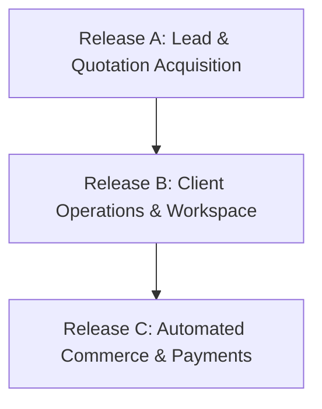

# ENGINE//OS — Production Launch Checklist & Release Gating
Version: 1.0 · Date: 2026-11-08 · Author: Gemini Coding Agent

---

## 1. Release Phasing Framework

ENGINE//OS follows a 3-stage controlled release strategy to achieve business value safely without waiting for every external integration:

### Stage Summary
- **Release A (Lead & Quotation Acquisition):** Public services, Solution Finder, Project Builder, validated brief intake, Staff Admin Leads Inbox, manual quotation creation. (No online payments, no client logins required).
- **Release B (Client Operations):** Customer auth, quote acceptance, orders, project workspace, requirement forms, file storage, deliverable sign-offs, revision budgets.
- **Release C (Automated Commerce):** Live payment gateways, transactional email/SMS dispatch, automatic billing reconciliation.

---

## 2. Pre-Flight Quality Gates (All Verified Locally)

| Quality Gate | Verification Requirement | Current Evidence | Status |
|---|---|---|---|
| **TypeScript** | `tsc --noEmit` exits 0 with zero errors | `npm.cmd run typecheck` passed | READY |
| **ESLint** | ESLint exits 0 with zero errors and zero warnings | `npm.cmd run lint` passed | READY |
| **Unit Tests** | Vitest test suite passes 100% | 46 tests across 10 files passed | READY |
| **E2E Tests** | Playwright desktop & mobile pass | 22 tests across Chromium and Mobile passed | READY |
| **Production Build** | Next.js Turbopack build compiles clean | 35 routes compiled in `next build` | READY |
| **Security Audit** | 0 production vulnerabilities | `npm audit --omit=dev` passed (0 vulns) | READY |

---

## 3. Staging Infrastructure Checklist (Pending Founder Action)

- [ ] **Staging Supabase Project Created:** New isolated project in Supabase Cloud.
- [ ] **Environment Variables Wired:**
  - [ ] `NEXT_PUBLIC_SUPABASE_URL`
  - [ ] `NEXT_PUBLIC_SUPABASE_ANON_KEY`
  - [ ] `SUPABASE_SERVICE_ROLE_KEY`
  - [ ] `PAYMENT_WEBHOOK_SECRET`
  - [ ] `CRON_SECRET`
- [ ] **Migrations Applied:**
  - [ ] `202611080001_engine_os_foundation.sql` executed without errors.
  - [ ] `202611080002_seed_canonical_services.sql` executed (10 categories, 12 services verified).
- [ ] **Storage Bucket Configured:** `project-files` bucket verified (private, 50MB max, MIME whitelist).
- [ ] **Initial Staff Profile Seeded:** Set `is_staff = true` for company operations account in `public.profiles`.

---

## 4. Legal & Commercial Governance Gates

- [ ] **Privacy Policy Approved:** Replace draft placeholder in `/privacy` with founder/counsel-approved policy.
- [ ] **Terms of Service Approved:** Replace draft placeholder in `/terms` with final binding agreement.
- [ ] **Refund Policy Approved:** Replace draft placeholder in `/refund-policy`.
- [ ] **Commercial Price Approvals:** Confirm BDT 999 promotional scope and regular tier price versions in `/admin/pricing`.

---

## 5. Production Deployment Day Checklist

- [ ] **DNS & SSL Verification:** Point `engine.notrealengine.online` (or custom domain) with TLS certificate.
- [ ] **Security Headers:** Verify HTTP security headers (`Strict-Transport-Security`, `X-Content-Type-Options`, `X-Frame-Options: SAMEORIGIN`, `Referrer-Policy`).
- [ ] **Monitoring Setup:** Configure `SENTRY_DSN` for error reporting and uptime alert monitoring.
- [ ] **Database Backup Automated:** Daily snapshot and Point-In-Time-Recovery (PITR) enabled in Supabase dashboard.
- [ ] **Controlled Handoff:** Complete staging verification run across Journey 1 (Lead -> Quote -> Order) and Journey 2 (Two-tenant isolation).
